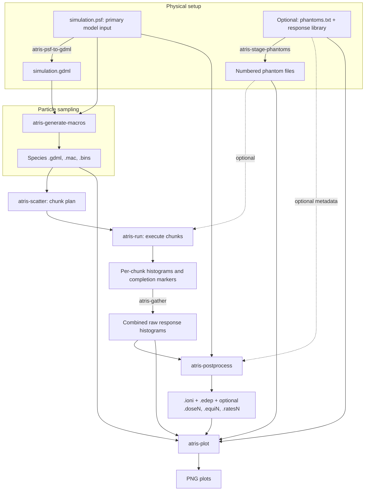

# Follow the files through an AtRIS run

This walkthrough follows one run directory from `simulation.psf` to
simulation results and plots. At each step, look at which files are read,
which are created, and what those new files are for.

The PSF is the primary model input; phantom response tables are optional.
We use a prepared PSF from the repository for this exercise. You can substitute
your own PSF without downloading any atmosphere data. We prepare the main Earth
example and run just one proton chunk and one alpha chunk to inspect the first
results. More chunks can then run without repeating completed work.

The AtRIS executable, Python commands, and plotting extra should already be
installed, with the Geant4 runtime available. `ATRIS_ROOT` should point to the
AtRIS directory you are using. All preparation and output files belong in a separate
run directory.

This tutorial uses local chunked execution for a small worked example. For reusable
instructions, follow [physics preparation](../running-atris/prepare-simulation.md),
[run the simulation](../running-atris/run-simulation.md), then
[process results](../running-atris/process-results.md). The physical inputs are the
same for local, server/workstation, and HPC jobs.

## The complete path



The diagram's phantom branch uses `phantoms.txt` both to select response tables
before the run and to supply mass/area metadata afterwards. The post-processor
reads that metadata, not the response library itself.

**An output from one command often becomes an input to the next.** For example,
`simulation.psf` is read by the geometry converter, macro generator, and
post-processor, regardless of how you obtained it. Keep it after creating
`simulation.gdml`.

## 1. Start with simulation.psf

From `runs/`, create and enter the run directory:

```bash
mkdir workflow-first
cd workflow-first
cp "$ATRIS_ROOT/examples/earth-nrlmsis-full/simulation.psf" .
```

This is the PSF from the [Earth preparation example](../tutorials/earth-nrlmsis-full.md).
We keep its atmosphere, energy range, and total requested event counts.
Chunking lets us run and inspect a small part of that calculation first.


Use a new directory name if `workflow-first` already exists. Run steps 2–8
from inside this directory.

It now contains one model file:

```text
workflow-first/
    simulation.psf
```

Phantoms are optional; step 4 shows how to add their response tables.

## 2. Inspect the primary model

`simulation.psf` describes material shells: their radii, detector IDs,
temperature, density, pressure, and composition. The prepared file contains
an interior, crust, atmosphere, and outer terminating layer.

Inspect it with `head -n 5 simulation.psf`. Its first line defines the materials;
the numeric layer rows follow. The [PSF reference](../reference/inputs.md#planet-specification-format-psf)
defines their units and meanings.

You can [write a PSF from scratch](../tutorials/exoplanet-psf.ipynb), use a prepared model,
or convert atmosphere data you already have. For Earth, [the NASA guide](../running-atris/download-nasa-atmosphere.md)
explains one optional route from NRLMSIS text to a PSF. The remaining workflow
starts from the PSF in each case.

## 3. Convert the PSF into Geant4 geometry

```bash
atris-psf-to-gdml simulation.psf
```

| Reads | Creates |
| --- | --- |
| `simulation.psf`, packaged material definitions | `simulation.gdml` |

The GDML is an XML representation of the layers and materials that Geant4 can
load. It contains the sensitive-detector tags used to associate output with
layers. The PSF remains the human-readable model and is still needed later.

There are now two files:

```text
simulation.psf
simulation.gdml
```

No particles have been simulated yet.

## 4. Optionally add phantom response matrices

Skip this step to run without phantom responses. Atmospheric transport, source
diagnostics, and ionizing and total energy deposition are available without
phantoms.

To add the example's two phantom responses:

```bash
cp "$ATRIS_ROOT/examples/earth-nrlmsis-full/phantoms.txt" .
atris-stage-phantoms . --copy
```

| Reads | Creates |
| --- | --- |
| `phantoms.txt`, selected named tables in `$ATRIS_ROOT/phantoms` | Local named response/counting table copies and four numbered symlinks |

`phantoms.txt` selects phantom IDs `0` and `1`, their table filename stems,
masses, and areas. It contains metadata, not the response matrices themselves.
The named copies in this example are:

```text
ramona_zero_0.060MeV_detA_response.txt
ramona_zero_0.060MeV_detA_counting.txt
icru_zero_0.000MeV_detAB_response.txt
icru_zero_0.000MeV_detAB_counting.txt
```

The executable expects numbered filenames rather than those descriptive
names. Staging connects the two:

```text
radiation_phantom0.txt -> ramona_zero_0.060MeV_detA_response.txt
counting_phantom0.txt  -> ramona_zero_0.060MeV_detA_counting.txt
radiation_phantom1.txt -> icru_zero_0.000MeV_detAB_response.txt
counting_phantom1.txt  -> icru_zero_0.000MeV_detAB_counting.txt
```

A symlink is a filesystem reference to its target file. `--copy` makes the
targets local, so these links remain usable when the whole run directory is
moved. Without `--copy`, the numbered links may point back to the shared library.
`ls -l radiation_phantom*.txt counting_phantom*.txt` shows their targets.

The response tables describe how crossing particles contribute to phantom
responses. They are not additional physical volumes added to the GDML.
Their coefficients are applied during transport, so the recorded response
histograms are tied to this phantom selection.

## 5. Prepare separate proton and alpha inputs

```bash
atris-generate-macros . \
  --particles-per-bin 3000 \
  --alpha-factor 0.66 \
  --energy-min-power 0 \
  --energy-max-power 6 \
  --energy-points 121 \
  --random-seed 12345
```

| Reads | Creates |
| --- | --- |
| `simulation.psf`, `simulation.gdml` | `protons.gdml`, `protons.mac`, `protons.bins` |
| The same model | `alphas.gdml`, `alphas.mac`, `alphas.bins` |

Each species needs three files:

| Extension | Role in the simulation |
| --- | --- |
| `.gdml` | Geometry. These are copies of `simulation.gdml`, so both species use the same atmosphere. |
| `.mac` | Commands to Geant4: primary species, source surface, energy sampling, seeds, and number of events. |
| `.bins` | Primary kinetic-energy bin edges used to organize the histograms. |

This example requests 363,000 proton events and 239,580 alpha events. Its 121
energy edges span 1–1,000,000 MeV for protons and 4–4,000,000 MeV for alphas. Despite the option
name, the generator multiplies `--particles-per-bin` by the number of **energy
points**, not intervals; see [the exact convention](../reference/inputs.md#energy-bins-and-macros).

The leading names `protons` and `alphas` tie each set together. Later, passing
`protons` to AtRIS makes it read all three `protons.*` inputs.

## 6. Plan and run chunks

Physics preparation is complete. In the same run directory, divide the planned
events into independently seeded chunks:

```bash
atris-scatter . --chunks 3000 --random-seed 12345
```

| Command | Reads | Creates |
| --- | --- | --- |
| `atris-scatter` | `protons.mac`, `alphas.mac` | `protons.chunk.mac`, `alphas.chunk.mac`, `chunks.txt`, empty `chunks/` |

Ordinary macros remain unchanged. Each species has 3000 chunks: 121 proton
events per chunk and 80 alpha events per chunk. The chunk macros contain these
per-chunk counts and no embedded seed command; `chunks.txt` supplies independent
seed pairs. No events have been simulated in this directory yet.

These small chunks let us try the full model without running the entire plan.
Runtime still depends on the sampled particles and the machine. For longer
runs, use the measured runtime to assess
[the chunk-size tradeoff](../running-atris/plan-chunks.md#choose-a-practical-chunk-size).

Run the first proton chunk and the first alpha chunk:

```bash
export G4FORCENUMBEROFTHREADS=4
atris-run . --entry 1
atris-run . --entry 3001
```

`--entry` selects one line of `chunks.txt`, numbered from one. In this plan,
lines 1–3000 are protons and lines 3001–6000 are alphas. Each command exits after
its selected chunk; the rest of the plan stays pending. Four threads are an
example setting; choose a count suitable for the machine.

| Reads | Creates |
| --- | --- |
| `chunks.txt`, species `.gdml`/`.bins`/`.chunk.mac`, optional `phantoms.txt` and numbered tables | Per-chunk raw histograms, a log, and a completion marker under `chunks/` |

A chunk's files have names like these; the seed numbers are illustrative:

```text
chunks/protons_123456_654321_h1_h1.1.csv
chunks/protons_123456_654321_h2_h2.ion.csv
chunks/protons_123456_654321_h2_h2.edep.csv
...other histogram files for that chunk...
chunks/protons_123456_654321.log
chunks/protons_123456_654321.COMPLETE
```

The marker is created when the subprocess succeeds. A later `atris-run` skips
marked entries and reruns incomplete ones. AtRIS discovers the staged numbered
phantom pairs directly; the runner uses `phantoms.txt` to label them in its
progress log.

## 7. Gather completed chunks

As soon as a chunk finishes, combine the available completed histograms.
You can do this in another terminal in the run directory while the remaining
chunks continue running:

```bash
atris-gather .
```

| Reads | Creates or updates |
| --- | --- |
| Plan, completion markers, completed chunk histograms, `simulation.psf` | Canonical response histograms at the run root |
| The same completed subset | `protons.gathered-chunks.txt`, `alphas.gathered-chunks.txt`, and species `.convergence.csv` files |

Response-mode chunks produce canonical CSVs; profile and shower chunks produce
one canonical ROOT file containing the summed response histograms and metadata.
The gathered-state files record which plan entries are included; convergence
CSVs appear once at least two chunks of a species have completed and report how
the ionization estimate changes as chunks are added. With only one chunk per
species, there are no convergence tables yet. Original chunk files remain.
Unfinished chunks are ignored. Repeat gathering and the processing below as
more chunks finish to update the results.

## 8. Process response tables and plots

First normalize the numerical results:

```bash
atris-postprocess .
```

| Reads | Creates |
| --- | --- |
| Raw proton and alpha CSV or ROOT histograms, `simulation.psf` | `.ioni` and `.edep` for each species |
| Optional raw phantom histograms and `phantoms.txt` | `.doseN`, `.equiN`, `.ratesN` for each selected phantom and species |

The post-processor also checks available `.bins` and `.mac` inputs for
consistency. The PSF supplies layer volumes and interface areas. When phantoms
are selected, `phantoms.txt` supplies their masses and areas. Keep these input files in the run directory; post-processing needs them.

For example, `protons.ioni` and `protons.edep` contain an ID column, an altitude
column, and one response column per primary-energy bin. They describe ionizing
and total energy deposited per volume per simulated primary. The phantom
products use their corresponding mass and area normalization. They are response
tables, not physical rates per second until an appropriate physical source
normalization is applied.

With only the first chunk of each species complete, some energy bins may be
unsampled and normalized values may be undefined. Run more chunks and assess
convergence before using the results for analysis.
The [normalization reference](../reference/outputs.md#processed-response-tables)
gives the precise formulas and units.

Then draw the results:

```bash
atris-plot .
```

| Reads | Creates |
| --- | --- |
| Prepared species inputs | Species input PNGs |
| Optional staged phantom tables and metadata | Phantom input PNGs |
| Processed response tables, raw diagnostic histograms, species geometry and energy axes | Species result PNGs, plus one result PNG per selected phantom/species |

The two species PNGs below are available without phantoms; the phantom PNGs
are added when step 4 was followed:

```text
protons.inputs.png                       # source and atmosphere inputs
phantom.ramona_zero_0.060MeV_detA.inputs.png
protons.png                              # source diagnostics and ionization
protons.ramona_zero_0.060MeV_detA.png       # phantom 0 responses
protons.icru_zero_0.000MeV_detAB.png        # phantom 1 responses
```

There are corresponding alpha plots. A PNG is a visual summary; the numerical
results remain in the response tables and raw histograms. Plotting does not implicitly
run AtRIS, gather chunks, or perform post-processing. You could also have run
`atris-plot` after step 5 to inspect inputs before simulating.

## Decide whether to continue

Inspect the input and response plots before launching the remaining chunks.
Check that they reflect the intended atmosphere, source, and phantoms, and use
the chunk logs and output sizes to assess the cost of the remaining run. See
[what to check](../running-atris/process-results.md#decide-whether-to-continue).

Use the first results to decide whether to revise the setup or continue.
If the setup looks right, process all remaining entries using the same inputs
and settings:

```bash
atris-run .
```

The two completed chunks are skipped. To sample a few more before committing
to the remaining run, select individual entries instead, for example `--entry 2`
and `--entry 3002`. Gather, post-process, and plot again whenever you want to
update the results. `atris-run . --check-complete` checks the whole plan; it is
expected to report unfinished work after this walkthrough's two chunks and is
not required before gathering.

## Where particle records fit

The walkthrough uses `--output-mode response` and the default
`--output-format csv`, producing histogram CSVs. To record interface crossings
in ROOT, generate the inputs with `--output-mode profile --output-format root`;
the resulting `<prefix>.root` contains the same response histograms and an
`interfaces` ntuple. `--output-mode shower --output-format root` also adds a
`steps` ntuple.

The ntuples are parallel outputs of the simulation. They do not replace the
histograms consumed by `atris-postprocess`. `atris-dump` can stream either
ntuple as CSV text, and `atris-plot` can inspect canonical species ROOT files.
Gather combines the response histograms but leaves the larger particle ntuples
in their per-chunk ROOT files.

## Which files to retain

Keep the PSF and species inputs with your results, together with phantom
metadata and response tables when used. Retain any source data from which you
constructed the PSF as model provenance. These explain what was simulated and allow results
to be interpreted or regenerated. Retain raw histogram CSV or ROOT files to repeat
post-processing without rerunning the simulation.

Processed tables and PNGs can be regenerated when their inputs are intact.
For chunked runs, retain the plan, shared chunk macros, chunk outputs, and
completion markers if you want to resume, extend, or rebuild the aggregate.
Changing an upstream input does not automatically refresh downstream files.
When revising the setup in place, account for existing outputs and completion
markers as described in [Decide whether to continue](../running-atris/process-results.md#decide-whether-to-continue).
